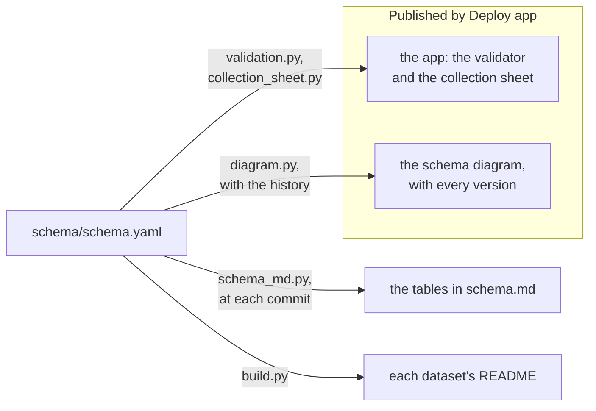

# For maintainers

This guide is for the people who look after this repository: who change the format, the validator and its app, the guides, the instructions for the AI and the publishing scripts, and who release new versions of the format. It says how the pieces fit together, how to work on them on your own computer, how the app and the diagram are published, and how a new version of the format is released.

## How the pieces fit together



`schema/schema.yaml` is the format: the tables and columns, their types and links, and a description of each column. The rest reads it, or is made from it:

- `app/validation.py`, the validator, checks tables against it, on the command line and in the app.
- `schema/schema_md.py` writes the tables in `schema/schema.md` that list the tables and columns. The rest of `schema.md` is written by hand.
- `app/collection_sheet.py` builds the blank collection sheet.
- `schema/diagram.py` draws the [schema diagram](#the-schema-diagram), from it and from every earlier version of it in the history.
- `publishing/build.py` lists its tables and columns in the README of each dataset on Zenodo.

There is only ever one `schema.yaml`, in `schema/`. It is never copied anywhere in the repository, and a test fails if a second one appears.

The addresses of the app and of this repository are written once, as `SITE` and `REPOSITORY` in `app/collection_sheet.py`, which the publishing scripts use too. The diagram has its own copy, `REPOSITORY` in `schema/diagram.html`.

The pictures in the README and in submit-data.md are drawn by `docs/images/draw.py`, as SVG files next to it. The diagrams in this guide and in publish-data.md are written in the guides, in [Mermaid](https://mermaid.js.org), which GitHub draws.

Before every commit, a hook, [.githooks/pre-commit](../.githooks/pre-commit), writes the tables in `schema.md` and draws the pictures, and adds them to the commit, so that every commit holds them as its sources make them. It stops the commit if `schema.yaml`, `schema.md` or `docs/images/` has changes that are not in it. Turn the hook on once in each clone, as in [Setup, done once](#setup-done-once).

Two Actions run on GitHub:

- **Tests** ([tests.yml](../.github/workflows/tests.yml)) runs the tests on every push.
- **Deploy app** ([deploy-app.yml](../.github/workflows/deploy-app.yml)) publishes the app and the diagram after every push to `main`, as in [Refreshing the app](#refreshing-the-app).

## On your own computer

Install uv, as in [Install what you need](submit-data.md#2-install-what-you-need), and run these in a terminal in the repository folder. uv runs each with Python 3.12 and the package versions in `app/requirements.txt`, the ones the app runs on, without installing them onto your computer.

**Check tables.** Give it a folder that holds the tables, as CSV files named after them or as one filled-in collection sheet, and `contributors.yaml`. Add `--out` and a new folder to get the tables back as clean CSV files. `--help` lists the options.

```
uv run --no-project --python 3.12 --with-requirements app/requirements.txt app/validation.py <folder>
```

**Start the app**, and open the address it prints, usually <http://127.0.0.1:8000>:

```
uv run --no-project --python 3.12 --with-requirements app/requirements.txt shiny run app/app.py
```

**Build a blank collection sheet:**

```
uv run --no-project --python 3.12 --with-requirements app/requirements.txt app/collection_sheet.py collection-sheet.xlsx
```

**Write the tables in `schema.md`**, to see them before you commit:

```
uv run --no-project --python 3.12 --with-requirements app/requirements.txt schema/schema_md.py
```

**Run the tests.** One runs the R code in the README of the datasets, and needs R; one runs the JavaScript of the diagram, and needs Node. On your own computer, each is skipped when R or Node is missing; on GitHub, it fails.

```
uv run --no-project --python 3.12 --with-requirements app/requirements.txt --with-requirements tests/requirements.txt pytest tests
```

**Draw the diagram**, to see a change before you push it. It is drawn in a browser, which this installs, once:

```
uv run --no-project --python 3.12 --with playwright==1.63.0 playwright install chromium
```

Then draw it, and open `site/diagram/index.html`. The `site/` folder is not committed.

```
uv run --no-project --python 3.12 --with-requirements app/requirements.txt --with playwright==1.63.0 schema/diagram.py site/diagram
```

**Draw the pictures** in `docs/images/`, to see a change to `draw.py` before you commit. It stops if a text no longer fits its box.

```
uv run --no-project --python 3.12 docs/images/draw.py
```

## The app

The validation app is at **<https://phenotheca.github.io/phenotheca/>**.

GitHub Pages only hands out the app's files. The app itself runs in each visitor's browser, with [Shinylive](https://shiny.posit.co/py/docs/shinylive.html), so the files they check never leave their computer. The first visit takes a while, as the browser downloads Python and the packages; later visits use its cached copy.

### Refreshing the app

Commit and push to `main` in GitHub Desktop. The *Deploy app* Action then:

1. runs the tests;
2. builds the app from `app/` and `schema/schema.yaml`;
3. draws the [schema diagram](#the-schema-diagram), with every version of `schema/schema.yaml` in the history;
4. opens the built app in a browser and checks it ([tests/check_browser_app.py](../tests/check_browser_app.py));
5. publishes both.

This takes a few minutes. If any step fails, nothing is published and the previous app stays up.

**Did it work?** On the repository's GitHub page, open the **Actions** tab. Each push has a *Deploy app* run with a green tick (published) or a red cross (failed). To see why a run failed, click it, then the job with the red cross, then the step with the red cross. GitHub also emails whoever pushed when a run fails.

To publish again without changing anything, go to **Actions → Deploy app → Run workflow**.

### What is checked before publishing

- All tests pass.
- The schema diagram draws every version of the schema without errors, with all its tables and links. The menu and the address switch between versions, and pointing at a column shows its description.
- The packages bundled with the app are the versions in `app/requirements.txt`.
- The app starts in a browser and shows no notices, so it runs the package versions in `app/requirements.txt`.
- The app hands out a blank collection sheet with the same contents as one built on the command line.
- The app gives the same messages as the command line for the valid test dataset, with its `contributors.yaml`, and for that blank collection sheet, and the files it hands back are the same.

### Package versions

The app runs on the browser's own Python, which has fixed versions of pandas, numpy, PyYAML and Shiny. They are set by the shinylive version in `deploy-app.yml`. `app/requirements.txt` pins the same versions, so the tests, the command line and the browser app all run the same ones. openpyxl is not part of the browser's Python; the app installs the version pinned in `app/requirements.txt` each time it starts.

The app and the command line both show a notice when they run another version than `app/requirements.txt`, for example:

```
Notice: This validator is tested with pandas 2.2.3, but pandas 3.0.6 is installed, so results may differ.
```

On your own computer, uv runs the tested versions, as in [On your own computer](#on-your-own-computer).

### Upgrading shinylive

Only upgrade when there is a reason to, such as a fix in Shiny that the app needs.

1. Change `shinylive==…` in `deploy-app.yml` to the new version, which is listed on [PyPI](https://pypi.org/project/shinylive/).
2. Push. If the new version brings other package versions, the browser check fails and says which versions to put in `app/requirements.txt`.
3. Change them, check that the tests pass on your own computer, and push again.

### The schema in the app

`schema.yaml` stays in `schema/`. The Action copies it next to `validation.py` in a folder outside the repository and builds the app from there, so the repository never holds a second copy. The schema is bundled into the app, which reads it from there. The site has no page or link to download it.

### The collection sheet

The app's *Download a blank collection sheet* button builds the sheet from `schema.yaml` when it is clicked, with [app/collection_sheet.py](../app/collection_sheet.py), so it always matches the schema the app checks against. Nothing else needs publishing.

## The schema diagram

The diagram of how the tables link is at **<https://phenotheca.github.io/phenotheca/diagram/>**. [schema/diagram.py](../schema/diagram.py) draws it each time the app is published, with every version of the schema:

- It opens at the latest version. The menu at the top switches to an earlier one.
- An address can name a version after `#`, as in `diagram/#1.0`, to open the diagram at that version. Link this way wherever the version matters: the *READ ME 1st* sheet of the collection sheet does, and so does the README of each dataset on Zenodo.
- Pictures of each version are at `diagram/<version>/diagram.png` and `diagram/<version>/diagram.svg`, and those of the latest also at `diagram/diagram.png` and `diagram/diagram.svg`.

### Where the versions come from

No copy of an earlier version is kept: the versions come from the git history. The latest version is `schema/schema.yaml` as it is. Each earlier version is `schema.yaml` as it was in the last commit that had that version, so the changes pushed under a version, such as a reworded description, show in the diagram of that version. Every version is read and drawn with the code of today.

So:

- **A version stays in the diagram for good once a commit with it is pushed.** Change the version in `schema.yaml` only when the format changes, and commit it only when the new version is final.
- **Never rewrite the history of `main`**, for example by force-pushing, or by squashing commits that are pushed: the earlier versions are in it.
- **A version written with zeros at the end is the same version.** Version 1.0 was first written 1.0.0, so the diagram shows the two as one, named as the latest commit writes it, and an address with either opens it.
- **The code has to read every earlier version.** A test reads each version in the history with today's `load_schema`. If a change to the code, or to how `schema.yaml` is laid out, makes an earlier version unreadable, that test fails, and nothing is published. Then make the code read the earlier version too; never leave it out.

The diagram needs the whole history, so the Actions fetch all of it (`fetch-depth: 0` in the workflows), and `diagram.py` will not run in a clone that holds only part of it. To see a change before pushing it, draw the diagram [on your own computer](#on-your-own-computer).

## Releasing a new version of the format

A new version of the format is a push to `main` that changes the version in `schema/schema.yaml`. [CHANGELOG.md](../CHANGELOG.md) says what makes a major version and what a minor one. As [Where the versions come from](#where-the-versions-come-from) says, a version stays in the diagram for good once a commit with it is pushed, so push the new version only when it is final.

1. Change `schema/schema.yaml`: the tables and columns, and the version, in quotes.
2. Change the hand-written parts of `schema/schema.md` that the change touches, and its version line. The tables in it that list the tables and columns are written by the hook when you commit.
3. Add the version to `CHANGELOG.md`, with its date and what changed, and set `version` and `date-released` in `CITATION.cff` to the same.
4. Change the test data in `tests/valid/`, the AI instructions and the guides where the change touches them.
5. Run the tests. One checks that `schema.yaml`, `CHANGELOG.md` and `CITATION.cff` give the same version.
6. Commit and push. The *Deploy app* Action publishes the app, which then checks against the new version, and the diagram, with the new version at `diagram/#<version>`. The README of each dataset links to the diagram of its version, so publish.py checks that it is online before it uploads a version.

After a new major version, the contributions have to be converted again before the next version of each dataset, as their tables fail the new validator, which build.py runs. A new minor version needs nothing of them: tables that passed still pass. The next version of each dataset says in its README which version of the format it follows, and its row in [datasets.md](datasets.md) is updated then.

## Setup, done once

In the repository's **Settings → Pages**, under *Build and deployment*, *Source* is set to **GitHub Actions**. Only an admin of the repository can change this.

In each clone of the repository, turn on the hook that writes `schema.md` and the pictures into every commit, with this command in a terminal in the repository folder. GitHub Desktop runs it too.

```
git config core.hooksPath .githooks
```

The address of the app and the diagram contains the names of the repository and of its organisation on GitHub. If either is renamed, or the repository moves to another organisation, the address changes, and the old one stops working: GitHub forwards links to the repository, but not to the site. So change the address wherever it is written: `SITE` and `REPOSITORY` in `app/collection_sheet.py`, which the *READ ME 1st* sheet, the README of the datasets and the publishing scripts use; `REPOSITORY` in `schema/diagram.html`; and the README, the guides, `schema.md`, `CITATION.cff` and the tests. `git grep` with the old name finds them all. A renamed repository is also cloned into a folder of its new name, which the guides and the AI instructions name. Update the address, too, anywhere else it was shared.
