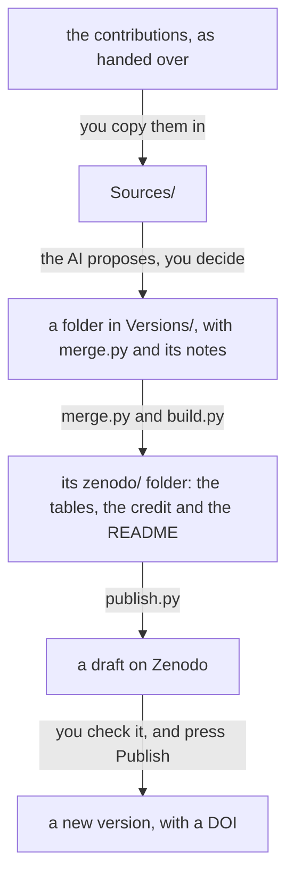

# Publishing data

This guide is for the data manager, who turns what contributors hand over into the datasets on Zenodo. It goes from the tables of the contributions to a published version of a dataset, in a folder that keeps everything that went into it. The AI that merges reads this guide too.

There is one public dataset, and a restricted dataset for each project whose data are not public yet. Each is a record on Zenodo with a DOI of all its versions, and each is published the same way: every merge of its contributions is a new version. A published version is never changed or taken back; a mistake is corrected in the next one. The public dataset is licensed under CC-BY-4.0. A restricted dataset is Other (Not Open) on Zenodo, and its README says that passing its data on, publishing from them or using them outside the project needs the permission of everyone who made them.

1. [Set up, once](#1-set-up-once)
2. [The dataset folder](#2-the-dataset-folder)
3. [Publish a version](#3-publish-a-version)
4. [Corrections](#4-corrections)

## 1. Set up, once

- **uv, git and an AI tool**, installed as in [Install what you need](submit-data.md#2-install-what-you-need).
- **A token for Zenodo.** publish.py uploads with a personal access token of the Zenodo account that owns the datasets, with the scopes `deposit:write` and `deposit:actions`, made under *Applications* in the account's settings. Save it in a file that holds nothing else, outside the dataset folders, and give publish.py the path of the file. A token for [sandbox.zenodo.org](https://sandbox.zenodo.org), the copy of Zenodo for trying things out, is made and kept the same way.
- **A folder per dataset**, laid out as below, where the datasets live.

## 2. The dataset folder

Each dataset has a folder, named after it:

```
<dataset>/                       one folder per dataset, named after it
  phenotheca/                    a copy of this repository
  zenodo.yaml                    the dataset on Zenodo: its title, access and curator, and its versions
  Sources/                       the contributions, as last handed over
    <contribution>/              one folder per contribution: its tables and contributors.yaml
  Versions/
    <date>/                      one merge per version
      Sources/                   a copy of Sources/ as it was merged
      merge.py                   the script: Sources/ → the tables, with every decision in it
      merge-notes.md             the decisions, and the answers behind them
      crosswalk.csv              every ID that merge.py changed, by contribution
      changes.md                 what changed in this version, and why
      zenodo/                    exactly what goes on Zenodo: README.md, one CSV file per table, contributors.yaml
```

`zenodo/` holds exactly what is on Zenodo: the README, built by build.py, and the tables and `contributors.yaml`, written by merge.py, and nothing else.

**zenodo.yaml** is written once, when the dataset is started. It gives the title, which Zenodo needs; the access, `open` for the public dataset, or `restricted` for a project's, whose files are then only for those given access on Zenodo; and the curator, who looks after the dataset and is its contact in the README, written as a person is in [Who to credit](submit-data.md#who-to-credit), without experiments. A restricted dataset has to name a curator, and the public dataset may:

```yaml
title: <title>
access: <open, or restricted>
curator:
  family_name: <family name>
  given_names: <given names>
  orcid: <ORCID iD, or none>
  affiliations:
    - name: <institution>
      ror: <ROR ID>
```

publish.py adds the DOI of all versions, and each version it uploads, with its folder, DOI and date. Leave those as they are. The versions on the sandbox are listed in `sandbox.yaml`, next to it.

The rules of the folder, for you and for the AI:

- **A contribution keeps its name.** Its folder in `Sources/` is named when it first comes, after the project it comes from, and never renamed: the crosswalks name it, and build.py follows the IDs of a version through them. When the contributor hands over again, the new tables replace the old ones in the same folder. The copy in each version's folder keeps what was merged.
- **Only you write in `Sources/`**, and you make its files read-only. The AI never changes them.
- **Only `merge.py` writes the tables and `crosswalk.csv`, and only `build.py` writes `README.md`.** Nothing in them is edited by hand, as the edit would be lost, and nobody could tell it was made.
- **The folder of a version is never changed, and never deleted.** The next merge starts from its `merge.py` and `merge-notes.md`, and compares with its tables to say what changed.
- **The copy of the repository is not edited.** Pull it before a merge, so that the merge follows the current version of the format. A version is published only from a commit that is on GitHub, as its README links to that commit.

## 3. Publish a version



1. **Get the contributions.** From each contributor, the `tables/` folder of their latest finished run, with its `contributors.yaml`, after a review that passes, as in [Have it reviewed](submit-data.md#9-have-it-reviewed). How they hand it over is [still to be decided](submit-data.md#10-hand-over). Copy it into the contribution's folder in `Sources/`, in place of what was there, and make the files read-only, as in [Set up the folder](submit-data.md#4-set-up-the-folder). A contribution without corrections or new data stays as it is.
2. **Update the copy of the repository.** In `phenotheca/`, run `git pull`. The first time, clone the repository into the dataset folder instead, as in [Set up the folder](submit-data.md#4-set-up-the-folder), and write `zenodo.yaml`.
3. **Merge with the AI.** Open your AI tool in the dataset folder, so that it sees `Sources/`, `Versions/` and the copy of the repository, as in [Open the folder in your AI tool](submit-data.md#5-open-the-folder-in-your-ai-tool), and type:

   > Read `phenotheca/merging/AI_INSTRUCTIONS.md` and follow it.

   The AI makes `Versions/<today>`, copies `Sources/` into it, starts from the last merge, checks each contribution with the validator, and looks for where the contributions overlap: the same trait under two IDs, the same person written in two ways, and so on. It asks you about every change, never more than three questions at once, and makes none without your yes. When you don't know, say so: then nothing changes. It writes every answer in `merge-notes.md`, so that the next merge does not ask again. It sees which contributions changed since the last version, and asks you why, for `changes.md`: what changed in this version, and why, for the people who use the data. It never reads the scores: merging rests on what the rows say, not on the values measured.

   Use the same line to come back to a merge, in a new session or after a break.
4. **Read the README.** When the merge is finished, the AI builds a preview of the version. Read `README.md` in the version's `zenodo/` folder in full, as someone who will use the data: every experiment is there, described, and has its contacts; the traits and their units are right; under *What changed in this version*, what changed agrees with `merge-notes.md`, and the reasons are the ones you gave; the citation names everyone in the contributions. Anything wrong goes back to the AI.
5. **Upload the version to a draft.** In a terminal in the dataset folder, run

   ```
   uv run phenotheca/publishing/publish.py Versions/<date> --token-file <path of the token file>
   ```

   It checks the version, the copy of the repository and the last version on Zenodo, and stops with a message that says what to do if something is not right. Then it makes a draft of the version on Zenodo, lists it in `zenodo.yaml`, builds the README with the date and the DOIs, uploads it with the tables, sets the metadata, and prints the address of the draft. Run it again after a change to the merge: it takes up the same draft, and uploads only what changed.

   The AI never runs publish.py: the token is yours.
6. **Check the draft, and publish.** Open the draft on Zenodo, and look at it as a reader would: the README; the files, the README, one CSV file per table and `contributors.yaml`; the creators, everyone in `contributors.yaml` in alphabetical order of family name, with their ORCIDs and affiliations; the funding; the licence, CC-BY-4.0 for the public dataset and Other (Not Open) for a restricted one; the access; the version number. Change nothing there by hand: what is on Zenodo should be what `zenodo/` holds, as the next version compares with it. Something wrong goes back to the merge, and publish.py uploads the fix. Then press *Publish*. Run publish.py once more, with the same line: it checks that what Zenodo published is what `zenodo/` holds, and says what to do next.
7. **Afterwards.** After the first version, add the dataset to [datasets.md](datasets.md), with its DOI of all versions, and push; after a later one, update its row if the version of the format changed. For a restricted dataset, give the project's people access to the files, on the record's page on Zenodo. Tell the contributors that the version is out, and its DOI.

**The sandbox.** Before the first version of the first dataset, and after a change to the scripts in `publishing/`, try publish.py on [sandbox.zenodo.org](https://sandbox.zenodo.org) first: the same line, with `--sandbox` and the file of the sandbox token. The versions on the sandbox are listed in `sandbox.yaml`, apart from those on Zenodo, so the same folder can be uploaded to both, and a later version can be tried there as long as the earlier ones are there too. Nothing on the sandbox counts, and it is cleared now and then.

## 4. Corrections

- **A mistake in a published version** is corrected in the next one. If it is in a contribution, the contributor corrects their conversion in a new run, and hands over again; if it is in the merge, the next merge gets a new decision. The next version's `changes.md` says what was corrected, and why.
- **A contribution that fails the validator** was made for an earlier version of the format, or was changed after its review. Ask the contributor for a new run.
- **publish.py stops** when something is not as it should be, and says what. Most often, the copy of the repository has changes, or is at a commit that is not on GitHub; the diagram of the format's version is not online yet, as the *Deploy app* Action is still running; or the latest version on Zenodo is not the last one in `zenodo.yaml`. Put it right, and run it again.

A new version of the format is released as in [Releasing a new version of the format](maintainers.md#releasing-a-new-version-of-the-format). After a new major version, every contribution has to be converted again before the next version of a dataset.
